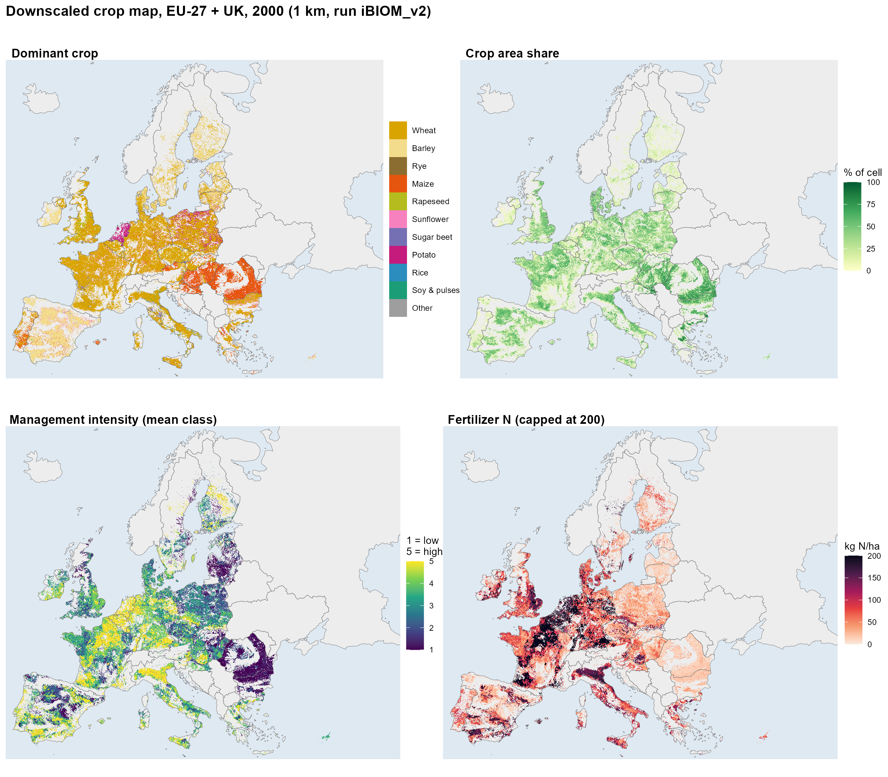
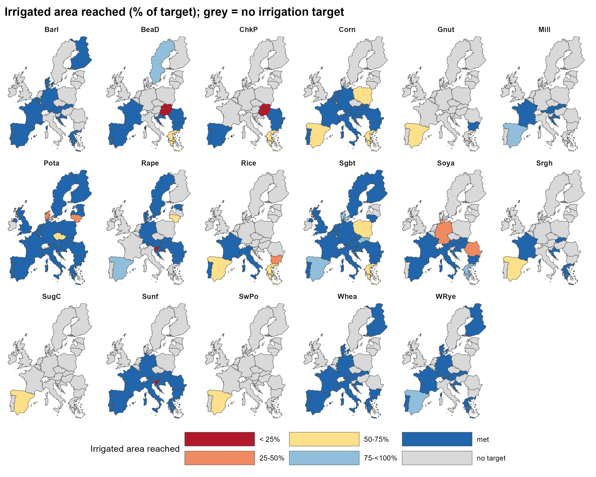
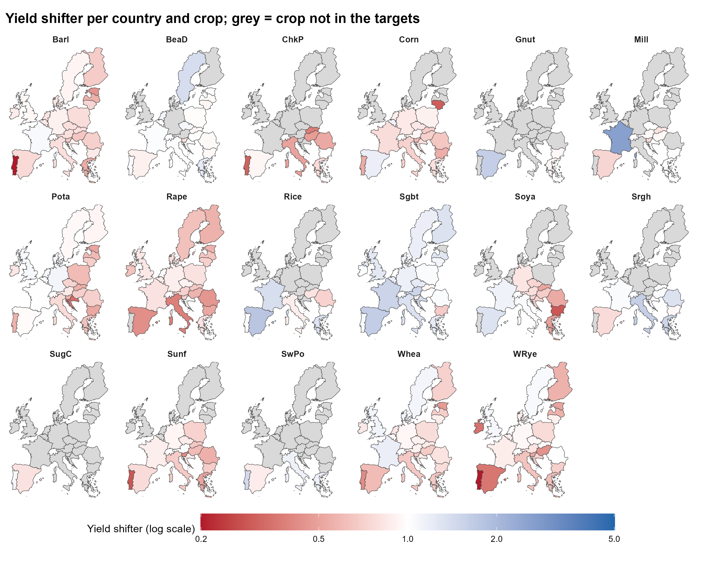

# Crop Distribution Downscaling System (CDDS)

**Title: Downscaled crop and management intensity map for the EU**

## Abstract
Agricultural land use and management have profound impacts on natural resources such as soils, biodiversity, and air quality. Modeling the long-term effects of anthropogenic activities on these resources requires a comprehensive understanding of crop distribution, cultivation intensity, and the associated management practices. 

This repository contains the Crop Distribution Downscaling System (CDDS), an R-based pipeline designed to downscale crop area and production targets to a high-resolution 1 km² EEA reference grid. We present a spatially explicit crop and intensity map that integrates crop distribution with management intensity on Corine land-cover (CLC) data. The produced maps are calibrated to meet utilized agricultural area (UAA) and production targets from GLOBIOM and historical FAO statistics, using bias correction methods as well as an updating routine to adjust energy intensity levels based on a biophysical yield model (EPIC-IIASA). The approach resolves major crop types at 5 input intensity classes at a 1 km resolution.

## 1. Introduction
Reducing the adverse environmental impacts of agriculture while improving resource management remains a crucial challenge for policymakers in the European Union. Effective environmental policies increasingly rely on ex-ante simulations that model the complex interactions between agricultural practices and the environment.

One critical aspect of these interactions is the intensity of agricultural inputs, particularly nitrogen fertilizers and intensive management practices. While high-input farming enhances short-term productivity, it has long-term negative consequences for multiple ecosystems. The environmental consequences of agriculture are highly dependent on local landscape characteristics, making spatial explicitness a critical factor in assessing impacts.

In this repository, we propose a crop and intensity mapping and harmonization approach designed for both ex-post and ex-ante modeling applications. Our method generates spatially explicit maps of crop distribution and management intensity, integrating probabilistic crop type estimates with agricultural statistics targets and high-resolution land-use data.

### Results

The figures below are from the latest full run (`iBIOM_v2`, EU-27 + UK, 2000). They are written by `codes/16_run_report.R`, which also produces a detailed run report with tables per country and crop (`output/<RESULT_TAG>/report/`).

**Final 1 km map.** Every 1 km cell holds the area of each crop in each management class, together with yield, fertilizer N, irrigation water and soil carbon. Summarised here per cell: the crop with the largest area, the share of the cell under the target crops, the area-weighted management intensity class and the mean fertilizer N.


**Targets.** The national area and production targets (FAO statistics) are met exactly for every country and crop. Irrigated area reaches 93% of the EU target: irrigation is only placed in cells with irrigated area in the Bonn layer, and in some countries there is too little crop area in those cells.


**Yield shifter.** Production is matched by scaling the input yields (EPIC, or old GLOBIOM data) per country and crop with a yield shifter = target production / production with the input yields. Values near 1 (white) mean the input yields agree with the statistics; red means the input yields are too high, blue too low. Fertilizer N, irrigation water and the SOC change are scaled with the same factor.


## 2. Data

This pipeline integrates several spatial and statistical datasets to generate consistent maps:

### Land Use and Management (LUM) Data
The foundation of our analysis is the Land Use and Management map (LAMASUS geodatabase), derived from the CORINE Land Cover (CLC) database. It differentiates between arable and permanent cropland and assesses management intensity using an irrigation layer and an energy input layer. Five arable intensity classes are utilized (LUM1 to LUM5), corresponding to very low to very high intensity.

### Crop Distribution Probabilities
We employ probabilistic crop maps that provide stochastic information about the prevalence of different crops at a 1 km² resolution. These are derived from satellite imagery, ground observations, climate data, and soil characteristics.

### Management-specific Yield and Emission Data (EPIC-IIASA)
A regional biophysical modeling framework (EPIC-IIASA) provides simulated yield and carbon variables specifically for the LUM classes. It simulates five incrementally increasing fertilization intensities for each crop and spatial simulation unit (SimU). These simulations are mapped to the respective LUM classes (e.g., LUM1 = low intensity rainfed, LUM5 = high intensity irrigated/rainfed).

## 3. Methodology & Code Workflow

The routine is executed per year $t$ and per region $j$, locally. Copy `user_config_TEMPLATE.R` to `user_config.R`, set `INPUT_DIR`, `RUN_YEARS` and `RESULT_TAG`, and run `main.R`. It sources the numbered scripts in `codes/` in order:

```
codes/
├── 01–03   run once     settings, input preparation, shared inputs
├── 04–12   per country  allocation of areas, irrigation, yields and additional variables
├── 13–15   after loop   summary over all countries, plots, SimU / GLOBIOM LU aggregation
├── support/            prep_* (input preparation), fun_* (helper functions), plot_targets.R
└── legacy/             earlier versions and the former Condor cluster setup, not used by main.R
```

### 3.0 Setup and Input Preparation
* `01_settings.R`: Input paths, prepared-input file paths, and the additional variables carried along with the yields (`extra_vars`, `scale_vars`).
* `02_prepare_inputs.R`: Runs a `codes/support/prep_*.R` script only if its output file does not exist yet (e.g. converting the old GLOBIOM `data_crops.gdx` to rds). To re-run a step, delete its output or list it in `FORCE_PREP` in `user_config.R`.

  | Step | Support script | Output |
  |---|---|---|
  | `country_grid` | `prep_country_grid.R` | `output/country_grid.rds` |
  | `EPIC_map` | `prep_EPIC_map.R` | `EPIC/MAP/EUEPIC_SimUID_1k_updt.rds` |
  | `SimU_CR_LU_map` | `prep_SimU_CR_LU_map.R` | `mappings/SimU_CR_LU_map.rds` |
  | `EPIC_yields` | `prep_EPIC_yields.R` | `EPIC/EPIC_yields.rds` |
  | `EPIC_vars` | `prep_EPIC_vars.R` | `EPIC/EPIC_vars.rds` (FTN, IRGA, OCPD, dOCPD) |
  | `GLOBIOM_old_crops` | `prep_GLOBIOM_old_crops.R` | `EPIC/cropyieldsOLD_GLOBIOM.rds`, `EPIC/cropvarsOLD_GLOBIOM.rds` |
  | `GLOBIOM_targets` | `prep_GLOBIOM_targets.R` | `targets/croptargets_GLOBIOM.rds` (only if `GLOBIOM_targets = TRUE`) |

* `03_load_shared_inputs.R`: Loads the country grid, the EPIC point map and the SimU shapes once for all countries.
* `SKIP_EXISTING` (`user_config.R`): if `TRUE`, the country loop skips every country x year whose result `output/<RESULT_TAG>/<reg>_<year>_<RESULT_TAG>.rds` exists. The rds is written only after the country outputs (12), so an interrupted run resumes at the first incomplete country. Delete the rds (or set `FALSE`) to recompute a country.

### 3.1 Initialization and Unharmonized Data
In the first step, land-use information from the LUM geodatabase is aggregated to the EEA 1 km² pixel level to define the crop production areas. The crop probabilities are applied to the given arable areas, yielding an initial, unharmonized distribution.

* `04_initialize_country.R`: Determines the input files and NUTS cells for the current country and year.
* `05_prepare_startmap.R`: Prepares the starting agricultural areas using the 100m LUM raster overlaid on the 1km² EEA grid.
* `06_prepare_priors.R`: Generates prior crop probabilities per grid cell based on multi-band suitability rasters.
* `07_load_EPIC.R`: Maps EPIC yields and the additional variables (fertilizer, irrigation water, SOC, C flux) per management class to the EEA grid. Crops without new EPIC data use the old GLOBIOM data.

### 3.2 Harmonization of Area
The utilized agricultural area for each crop is adjusted so that the sum across all cells within a region matches the target agricultural area. A bias correction approach is applied, proportionally adjusting the prior probabilities to ensure the total allocated area aligns with the regional total. 

* `08_prepare_targets.R`: Prepares the area, production and irrigation targets. This toggles between **GLOBIOM** (`croptargets_GLOBIOM.rds`) and historical **FAO** (`faostat_avg_1998_2002.rds`) targets; irrigation targets come from AQUASTAT.
* `09_area_matching.R`: The core spatial allocation engine. It uses the `downscalr` package to distribute the regional targets into the 1km² crop area using the adjusted priors as weights.
* `10_irri_matching.R`: Allocates the irrigation targets using the irrigated area per cell binned into likelihood classes (91–100 ha first, cells with 0 ha excluded).

### 3.3 Harmonization of Production
Having harmonized the areas for all crops, these areas are combined with input intensity levels from the LUM geodatabase and pixel-specific yield data from EPIC-IIASA. The yields are scaled uniformly per crop and region so that the production targets are met; the additional variables are scaled with the same factor.

* `11_production_matching.R`: Builds the final allocation per cell × management class × crop and applies the yield adjustment. Includes automatic checks: the allocated area must equal the LUM crop area (in total and per cell), and yields must increase with management intensity.
* `12_country_outputs.R`: Writes national files (area, yield and each additional variable) as GeoPackage, GeoParquet (if the GDAL driver is available) and Cloud-Optimized GeoTIFF.

## 4. Results

For each region and year, `main.R` saves `final.alloc`, `show.res`, `result` and the irrigation overview as `.rds` files into `output/<RESULT_TAG>/`, and the national files into `output/<RESULT_TAG>/country_res/`. After the country loop:

* `13_summarise.R`: Combines all countries into one table (`agg.res`, saved in `output/<RESULT_TAG>/aggregated/`).
* `14_plot_results.R`: Plots area, production and irrigation against the targets.
* `15_aggregate_SimU_LU.R`: Aggregates areas (sum) and per-ha variables (area-weighted) to SimU and the GLOBIOM LU grid.
* `16_run_report.R`: Writes a run report (`output/<RESULT_TAG>/report/`, Markdown + self-contained HTML, figures and csv tables) with target fulfilment for area, production and irrigation, yield shifters, the additional variables, the SimU coverage and the git commit of the code. Can also be run on its own after a finished run: `source("user_config.R"); source("./codes/01_settings.R"); source("./codes/16_run_report.R")`.

> [!NOTE] 
> **Input Information Needed:** Final Output Visualizations 
> 
> `[Insert plots of harmonized crop area here]`
> `[Insert plots of harmonized crop production here]`

## 5. Additional Variables, Crosswalk and Data Fixes

### 5.1 Additional per-ha variables
Next to the yield (`YLD`, t/ha), every crop × management class × cell carries:

| Column | Description | Unit | EPIC source | Old GLOBIOM source (`data_crops.gdx`) |
|---|---|---|---|---|
| `FTN` | N fertilization | kg N/ha | `N` scenario code of the runs (e.g. `N250`) | `FTN` |
| `IRGA` | irrigation water | mm | `IRGA/` (M5.ir only, 0 for rainfed) | `WATER` × 100 (1000 m³/ha → mm), IR only |
| `OCPD` | topsoil organic C stock (SOC) | t C/ha | `OCPD/` `OCPD.init` | – |
| `dOCPD` | annual change in SOC (C flux / emissions) | t C/ha/yr | `OCPD/` `dOCPD` | – |

A crop takes its values from the new 1 km² EPIC runs if EPIC simulates it; otherwise from the old GLOBIOM data. The variables listed in `scale_vars` (`01_settings.R`; default `FTN`, `IRGA`, `dOCPD`) are multiplied by the same per-crop production adjustment factor as the yield. The SOC stock `OCPD` is not scaled: a soil C stock does not depend on the yield bias, and scaling it produced artefacts (e.g. potato in Croatia, factor 0.34, would get 10 t C/ha next to 22–39 t C/ha for the other crops in the same cells).

### 5.2 Crop crosswalk for crops without EPIC data
GLOBIOM provides no SOC or C flux, so crops not simulated by EPIC take `crosswalk_vars` (default `OCPD`, `dOCPD`) from the EPIC data of the most similar simulated crop, in the same cell and management class. The table is `codes/support/crop_crosswalk_EPIC.csv`:

| Crop | EPIC proxy | Rationale |
|---|---|---|
| Srgh (sorghum) | Corn | C4 summer cereal with similar phenology and management |
| Mill (millet) | Corn | C4 summer cereal |
| SugC (sugar cane) | Corn | C4 perennial grass; closest C4 crop simulated (not grown in the EU) |
| BeaD (dry beans) | Soya | N-fixing grain legume |
| ChkP (chickpea) | Soya | N-fixing grain legume |
| Gnut (groundnut) | Soya | N-fixing oilseed legume |
| Cott (cotton) | Sunf | warm-season dicot row crop, deep rooting, long season |
| Cass (cassava) | Pota | root/tuber crop, similar residue and soil disturbance at harvest |
| SwPo (sweet potato) | Pota | root/tuber crop |

`FTN` and `IRGA` keep the crop-specific GLOBIOM values by default: EPIC applies the same N schedule to all crops (up to 250 kg N/ha at M5, also for soybean), which would strongly overstate N for legumes. To take them from the crosswalk as well, add them to `crosswalk_vars`. Cyprus and Malta have no EPIC coverage, so no crosswalk values exist there.

### 5.3 Data fixes and their cause
* **EPIC point offset (`03_load_shared_inputs.R`).** The EPIC SimUID points (`EUEPIC_SimUID_1k_updt`) should sit exactly at the 1 km cell centres, but ~13% of them (623k of 4.9M) are shifted by up to 0.5 m (e.g. x mod 1000 = 499.73). The fast coordinate join to the EEA grid requires an exact match, so these points were silently dropped. The coordinates are now rounded to the cell origin. Effect: in Croatia almost all points are affected — only 20 of 16,604 crop cells (the border pixels) were matched before, 16,593 after. Elsewhere the effect is negligible (+1 cell in SI, +4 in HU; Austria results are identical).
* **Croatia override removed (`07_load_EPIC.R`).** Because only the border pixels of Croatia had EPIC data (a consequence of the offset above), Croatia used old GLOBIOM yields for all crops that GLOBIOM covers. With the offset fixed, Croatia is handled like every other country.
* **OthAgr double count (`11_production_matching.R`).** OthAgr was allocated once per LUM class and again as its own row; it is now only added once. An automatic area-balance check after each country verifies that crops × management classes + OthAgr equal the LUM crop area, in total and per cell.
* **Irrigation likelihood classes (`10_irri_matching.R`).** The irrigated area per cell (0–100 ha) is binned into 10 classes; irrigation targets are filled from 91–100 ha downwards, and cells with 0 ha never receive irrigation. Before, the bins counted upwards and were filled starting from the least irrigated cells.
* **GLOBIOM LU codes (`15_aggregate_SimU_LU.R`).** `AllColRow` is taken from the LU codes (`ALLCOLROW`), as used in the GLOBIOM GDX, instead of the CR codes.
